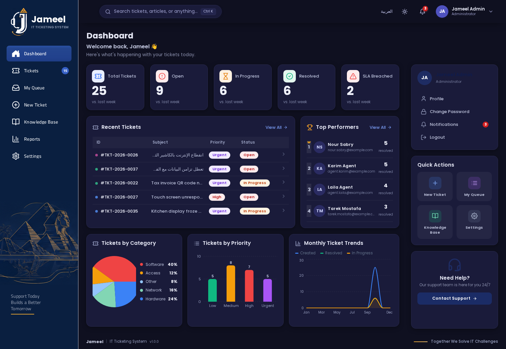
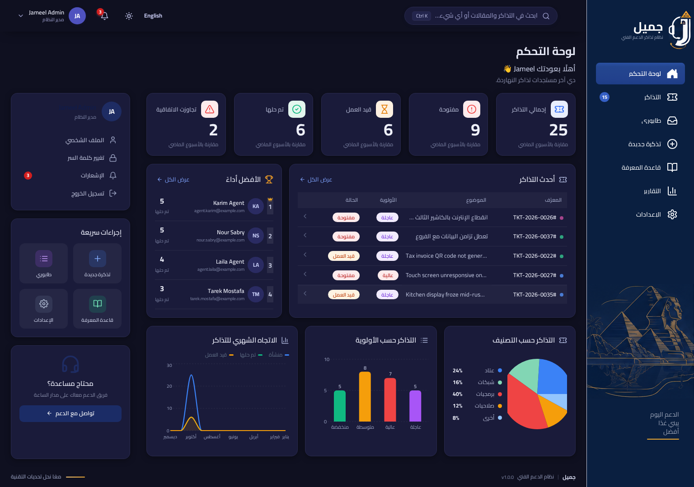
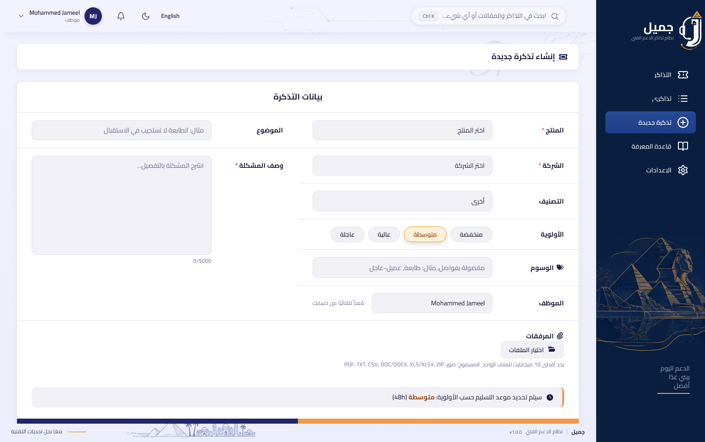
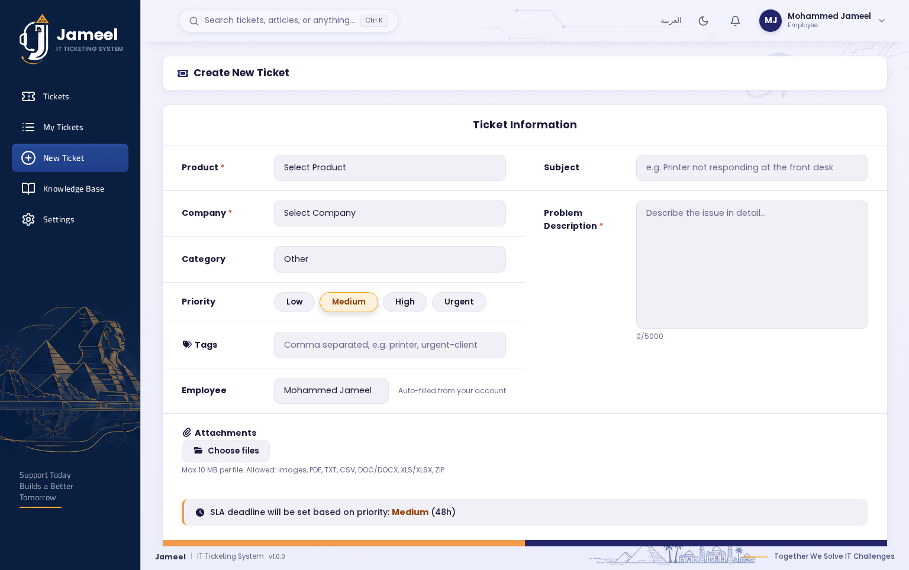
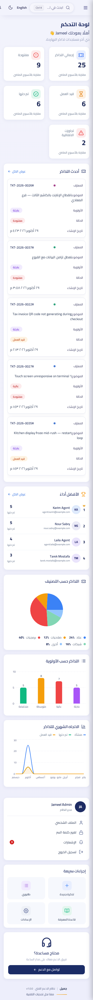
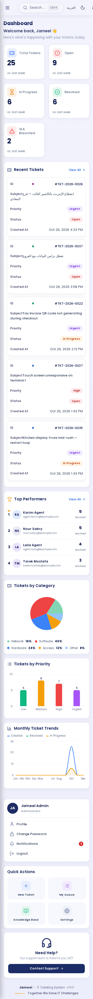
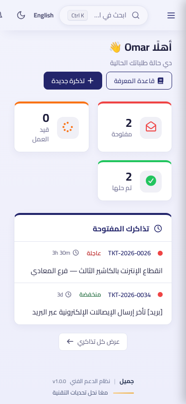
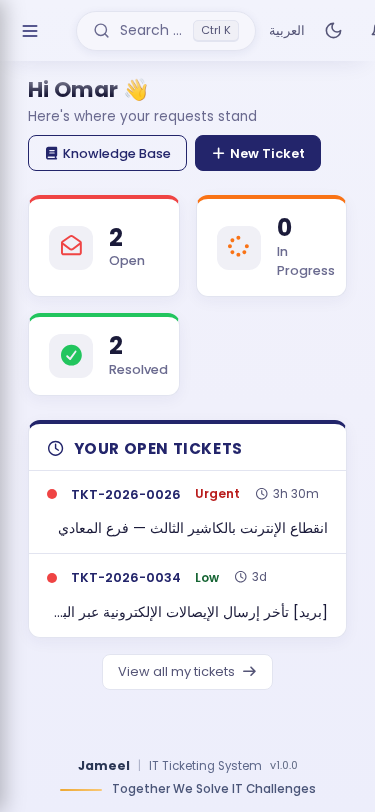

<div align="center">

# 🎫 Jameel IT — Help Desk & Ticketing Platform

**Bilingual (Arabic-first RTL / English) full-stack IT support platform** —
employees report issues, agents triage them in real time, admins run the whole operation.

**👨‍💻 Designed & built by [Mohammed Jameel](https://imohammedjameel.github.io/)**
[](https://www.linkedin.com/in/imohammedjameel/)
[](https://imohammedjameel.github.io/)

[](https://react.dev)
[](https://vitejs.dev)
[](https://nodejs.org)
[](https://expressjs.com)
[](https://mongoosejs.com)
[](https://socket.io)
[](#-testing--ci)
[](#-testing--ci)
[](#-bilingual--rtl)
[](./LICENSE)
[](https://github.com/iMohammedJameel/IT-Ticketing-System/actions/workflows/ci.yml)
[](https://github.com/iMohammedJameel/IT-Ticketing-System/actions/workflows/e2e.yml)

**70 REST endpoints · 10 data models · 159 backend tests · Playwright E2E · realtime everything · full RTL with zero flash**

</div>

---


<sub align="center">Admin analytics dashboard — stat cards, SLA trends, CSAT, top performers</sub>

<table>
<tr>
<td width="50%"><sub><b>Arabic (RTL)</b> — full RTL layout, Cairo font, direction-aware components</sub></td>
<td width="50%"><sub><b>Dark mode</b> — theme persisted per user, charts included</sub></td>
</tr>
</table>

---

## ✨ Engineering highlights

| | |
|---|---|
| 🔁 **Realtime by default** | Socket.io personal rooms, role rooms and *authorized ticket rooms* — live refresh while a ticket is open, agent presence dots |
| ⏱️ **SLA engine** | Per-priority policies (72/48/24/4h) with optional *business-hours-only* counting (skips nights/weekends), hourly monitor with distributed lock, breach escalation to admins — including unassigned tickets |
| 🌍 **True bilingual** | Arabic-first full RTL / English LTR — the Bootstrap RTL build is swapped **before first paint** (no flash), 624-key dictionaries in perfect parity, logical CSS properties throughout |
| 🔐 **Security-first** | JWT access + rotating refresh with reuse detection, TOTP 2FA (zero-dependency RFC 6238), brute-force lockout, anti-enumeration auth, NoSQL sanitizer, CSV formula-injection hardening, magic-byte attachment validation |
| 🧪 **159 green tests** | Unit + integration on an in-memory MongoDB (`mongodb-memory-server`) — TOTP RFC test vectors, business-hours SLA math, RBAC, CSAT, search, CSV injection — plus a Playwright E2E suite wired into CI |
| ⚙️ **Ops-ready** | OpenAPI 3 spec + live Swagger UI, GitHub Actions CI (lint → tests → build → docker images) + a full-stack E2E workflow, pluggable disk/S3 storage (zero-dep SigV4), structured logs with request IDs |
| ✉️ **Email → ticket** | Inbound webhook (`POST /api/inbound/email`) auto-provisions customer accounts and companies from sender domains |
| 📉 **KB deflection** | Matching help articles suggested *while typing* a ticket; one-vote-per-user helpfulness rating |

## 🧑‍💻 Feature tour by role

| Role | What they get |
|---|---|
| **Employee (`user`)** | Ticket wizard with KB suggestions while typing + draft autosave + attachments · priority & deadline quick-pills with WCAG-AA active states · live SLA notice that updates with priority · SLA countdowns on their tickets · comments · CSAT rating after resolution · close-the-loop CTA · knowledge base & voting · notifications |
| **Agent (`agent`)** | **My Queue** triage (assigned / unassigned / SLA-at-risk) · status stepper & priority control · internal notes · canned responses (usage-ranked) · bulk assign/status · company directory · service metrics dashboard |
| **Admin (`admin`)** | Everything + user management (roles/teams/suspend) · KB authoring (AR/EN, drafts) · canned responses & companies & SLA policies · CSV export (injection-hardened) · full analytics & reports |

**Cross-cutting:** command palette (`Ctrl+K` — tickets, KB, actions) · dark mode · mobile-first (tables collapse to stacked cards) · audit history per ticket (capped at 200 entries) · localized relative timestamps (`منذ ٥ دقائق` / `5 minutes ago`) · accessibility (keyboard-navigable rows, focus rings, WCAG AA text).

## 📸 Screenshots

Every screen ships in both languages — Arabic (RTL) on the left, English (LTR) on the right:

### Dashboards — light & dark

| Arabic (RTL) | English (LTR) |
|---|---|
|  <sub>Admin dashboard — light</sub> |  <sub>Admin dashboard — light</sub> |
|  <sub>Admin dashboard — dark</sub> |  <sub>Admin dashboard — dark</sub> |

### Auth, tickets & agent queue

| Arabic (RTL) | English (LTR) |
|---|---|
|  <sub>Login</sub> |  <sub>Login</sub> |
|  <sub>New-ticket wizard — priority & deadline pills, attachments, live SLA notice</sub> |  <sub>New-ticket wizard</sub> |
|  <sub>Tickets queue — filters, SLA chips, pagination</sub> |  <sub>Tickets queue</sub> |
|  <sub>Ticket detail — comments, internal notes, history timeline</sub> |  <sub>Ticket detail</sub> |
|  <sub>Agent "My Queue" — triage view</sub> |  <sub>Agent queue</sub> |

### Reports, users & employee home

| Arabic (RTL) | English (LTR) |
|---|---|
|  <sub>Reports — first response, resolution, SLA compliance, CSAT</sub> |  <sub>Reports & analytics</sub> |
|  <sub>User management (roles / teams / suspend)</sub> |  <sub>User management</sub> |
|  <sub>Employee home — active tickets & SLA countdowns</sub> |  <sub>Employee home</sub> |

### Mobile (375px — full-page scrolls)

*Every mobile capture is a complete full-page scroll — nothing is cropped mid-element.*

<table>
<tr>
<td width="50%" align="center"><br><sub><b>Admin dashboard (Arabic)</b> — tables collapse to stacked cards</sub></td>
<td width="50%" align="center"><br><sub><b>Admin dashboard (English)</b></sub></td>
<td width="50%" align="center"><br><sub><b>Employee home (Arabic)</b></sub></td>
<td width="50%" align="center"><br><sub><b>Employee home (English)</b></sub></td>
</tr>
</table>

## 🏗️ Architecture

```
┌─────────────────────┐                        ┌───────────────────────────────┐        ┌──────────────┐
│  React 19 SPA       │  REST  /api + /api/v1  │  Express 4 API                │        │  MongoDB     │
│  (Vite 8)           │◄──────────────────────►│  · JWT + RBAC middleware      │◄──────►│  (Mongoose)  │
│  Bootstrap LTR/RTL  │  WebSocket             │  · 70 routes, 10 models       │        │  atomic      │
│  CSS Modules        │◄──────────────────────►│  · Socket.io rooms/presence   │        │  counters    │
│  Recharts           │                        │  · SLA monitor (hourly, lock) │        └──────────────┘
└─────────────────────┘                        │  · inbound email webhook      │──► S3 / disk uploads
                                               │  · OpenAPI + Swagger UI       │──► SMTP (optional)
                                               └───────────────────────────────┘
```

| Layer | Stack |
|---|---|
| **Frontend** | React 19 · Vite 8 · Bootstrap 5 (runtime LTR↔RTL swap) · CSS Modules · Recharts · socket.io-client · custom i18n (624 keys × 2) |
| **Backend** | Node 18+ · Express 4 · Mongoose · Socket.io · JWT (access + rotating refresh) · zero-dep TOTP · Nodemailer · Vitest + Supertest |
| **Testing** | Vitest (159 unit + integration) · Playwright E2E (auth, tickets, KB, navigation — bilingual flows) · i18n parity check script |
| **Infra** | Docker Compose (dev + prod) · GitHub Actions CI · pluggable storage (disk / any S3-compatible) |

## 🚀 Quick start

### Local development

```bash
# 1 — Backend  (http://localhost:5000)
cd Backend
cp .env.example .env          # defaults work out of the box for local dev
npm install
npm run seed:demo             # demo users · tickets · companies · KB articles
npm run dev

# 2 — Frontend (http://localhost:5173)
cd ../frontend/it-help-desk
npm install
npm run dev
```

> Requires a MongoDB instance (`mongodb://localhost:27017` by default — change `DB_URL` in `.env`).

### Docker

```bash
docker compose up -d --build
docker compose exec backend npm run seed:demo   # first run only
```

### Demo accounts (seeded)

| Role | Email | Password |
|---|---|---|
| **Admin** | `admin@jameel-it.com` | `password123` |
| **Agent** | `agent.laila@example.com` | `Demo@1234` |
| **Employee** | `omar.khaled@example.com` | `Demo@1234` |

> ⚠️ Change all three (plus JWT secrets) before any real deployment — production boot **refuses placeholder secrets**.

## 🔌 API

- Live docs: `GET /api/docs` (OpenAPI 3 spec) and `GET /api/docs-ui` (Swagger UI)
- Every route is versioned twice: `/api/...` and `/api/v1/...`
- Highlights: auth (login/register/refresh/MFA/verify), tickets (filters, bulk, CSV export), comments (public + internal notes), KB (search, votes), companies, canned responses, notifications, inbound email webhook

## 🧪 Testing & CI

```bash
cd Backend && npm test                    # 159 tests — no local MongoDB needed (in-memory)
cd Backend && npm run lint                # ESLint — 0 errors
cd frontend/it-help-desk && npm run lint  # ESLint — 0 errors
cd frontend/it-help-desk && npm run test:e2e:full   # full-stack E2E (seed → boot → Playwright)
```

CI runs on every push/PR in two workflows:

- **`.github/workflows/ci.yml`** — backend lint + 159 tests → frontend lint + build → docker image builds. No repo secrets required — tests boot their own throwaway in-memory MongoDB.
- **`.github/workflows/e2e.yml`** — full-stack Playwright E2E (MongoDB service container → seeded backend → built frontend preview → bilingual UI flows), with the Playwright report uploaded on failure.

## 📂 Project structure

```
.
├── Backend/
│   ├── app.js                  # Express bootstrap + middleware chain
│   ├── config/                 # env validation (fails fast on bad config)
│   ├── controller/             # request handlers (tickets, auth, KB, ...)
│   ├── middleware/             # auth, RBAC, errors, validation
│   ├── models/                 # 10 Mongoose schemas + atomic counters
│   ├── routes/                 # REST routing (/api and /api/v1)
│   ├── services/               # SLA monitor, sockets, email, storage (disk/S3)
│   ├── seedUsers.js            # demo users across the 3 roles
│   ├── seedDemo.js             # tickets, companies, KB, canned, notifications
│   └── tests/                  # 159 Vitest unit + integration tests (14 files)
├── frontend/it-help-desk/
│   ├── src/pages/              # role-aware routes (dashboard, queue, home, ...)
│   ├── src/components/         # layout, tickets, dashboard, shared UI
│   ├── src/i18n/               # AR / EN dictionaries (624 keys each) + parity script
│   ├── tests/e2e/              # Playwright E2E suites
│   └── src/                    # contexts (auth, theme, lang), api client
├── docs/screenshots/           # every screen in Arabic AND English
├── docker-compose.yml          # mongo + backend + frontend
└── .github/workflows/          # ci.yml (lint/test/build/docker) + e2e.yml (Playwright)
```

## 🔐 Security notes

- **Env validation with fail-fast** — production boot rejects placeholder/weak JWT secrets and secrets that match each other
- Rotating refresh tokens with **reuse detection** (stolen-token kill switch)
- Brute-force lockout (5 attempts / 15 min) + separate stricter auth rate-limit window
- Anti-enumeration: duplicate registration returns an identical success response
- Uploads: extension + MIME + **magic-byte** validation, UUID filenames, authenticated downloads, forced `Content-Disposition`
- CSV export neutralizes formula injection (`=`, `+`, `-`, `@`, TAB, CR)
- Helmet, CORS allowlist, HPP, mongo-sanitize, request IDs on every response

## 🌍 Bilingual & RTL

The UI ships **Arabic-first with complete RTL** and toggles to English/LTR instantly from the navbar:

- The correct Bootstrap build (LTR or RTL) is chosen **before first paint** — no layout flash, ever
- Cairo font for Arabic; logical CSS properties (`margin-inline`, `padding-block`) everywhere
- Direction-aware sidebar drawer, toasts, chart axes, table sorting indicators, select chevrons, action-button corner radii and notice accent bars — everything mirrors correctly between LTR and RTL
- WCAG AA contrast enforced on interactive states — e.g. the ticket wizard's active priority/deadline pills use a tinted chip + theme-aware ink in both light and dark modes
- 624-key dictionaries in **perfect AR↔EN parity** (enforced by `scripts/check-i18n-parity.mjs`)
- Localized relative timestamps, dates and numbers
- Bidi-safe text rendering — mixed Arabic/English subjects keep their natural direction inside RTL tables (`unicode-bidi: plaintext`)

## 📄 License & attribution

[MIT](./LICENSE) — free to use, learn from, and build upon.

**Forking & modifying this project? You're welcome — just keep the attribution.**
The [NOTICE](./NOTICE) file explains what the MIT license requires you to keep:
the LICENSE + NOTICE files, the per-file `/*! … */` source headers, and the
embedded signature marks (`JMLIT-…`) that live in the API response headers,
the web-app console, the built JS/CSS bundles and the Docker image labels.
They don't affect functionality in any way — they exist so authorship stays
traceable. Building on this repo with the notices intact is explicitly welcomed 🤝

## 👤 Author

<div align="center">

**Mohammed Jameel** — Full-Stack Developer

[](https://www.linkedin.com/in/imohammedjameel/)
[](https://imohammedjameel.github.io/)

*Building products that speak the user's language — literally.* 🌍

</div>
